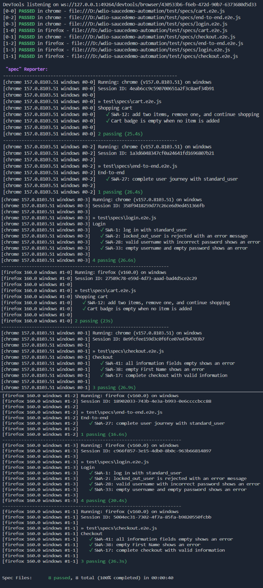

# WebdriverIO Test Automation: SauceDemo

UI test automation for [SauceDemo](https://www.saucedemo.com) using WebdriverIO and the Page Object pattern. The scenarios are taken from my manual test cases (see [manual-qa-portfolio](https://github.com/obyy47/manual-qa-portfolio)), and each test name includes the ID of its Qase test case.

## Tools

- WebdriverIO and Mocha
- Node.js
- Chrome and Firefox (each spec runs in both browsers)

## Project structure

```
wdio-saucedemo-automation/
├── README.md
├── package.json
├── wdio.conf.js
├── screenshots/
└── test/
    ├── pageobjects/
    │   ├── login.page.js
    │   ├── inventory.page.js
    │   ├── cart.page.js
    │   └── checkout.page.js
    └── specs/
        ├── login.e2e.js
        ├── cart.e2e.js
        ├── checkout.e2e.js
        └── end-to-end.e2e.js
```

**Page Object pattern:** each page has its own file with its selectors and actions. The specs contain only the test steps and assertions, so if a selector changes, I only update one file.

## Automated scenarios (10 tests)

| Spec | Test | Qase test case |
|---|---|---|
| login | Log in with `standard_user` | SWA-1 |
| login | `locked_out_user` is rejected with an error message | SWA-2 |
| login | Valid username with incorrect password shows an error | SWA-28 |
| login | Empty username and password shows an error | SWA-33 |
| cart | Add two items, remove one, and continue shopping | SWA-12 |
| cart | Cart badge is empty when no item is added | |
| checkout | All information fields empty shows an error | SWA-41 |
| checkout | Empty First Name shows an error | SWA-38 |
| checkout | Complete checkout with valid information | SWA-17 |
| end-to-end | Full journey: login, add items, checkout, logout | SWA-27 |

Each test starts from a clean state (cookies and local storage are cleared), so tests do not depend on each other.

## Not automated, and why

- **`problem_user`, `error_user`, `visual_user` cases:** these accounts have intentional bugs, which I covered in manual testing and reported in Jira.
- **Visual layout and delay checks:** better verified manually.
- **Whitespace-only and empty-cart checkout:** these are known issues found in manual testing, so an automated test would fail by design.

## How to run

```
npm install
npx wdio run ./wdio.conf.js
```

Run a single spec:

```
npx wdio run ./wdio.conf.js --spec ./test/specs/login.e2e.js
```

## Results

All 4 spec files pass in both Chrome and Firefox.



## Next

- Run the tests in CI (GitHub Actions)
- Add a Selenium version of the same scenarios for comparison
